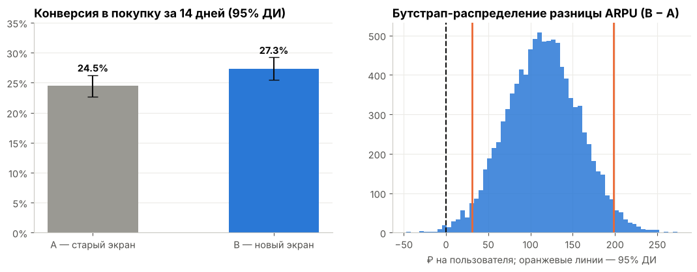
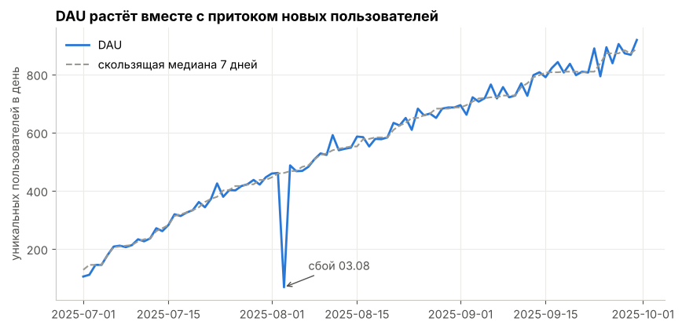
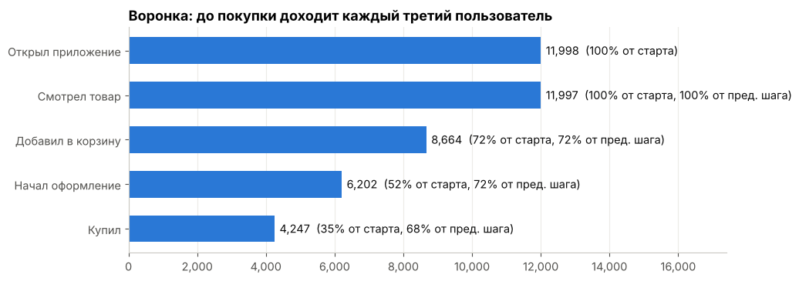
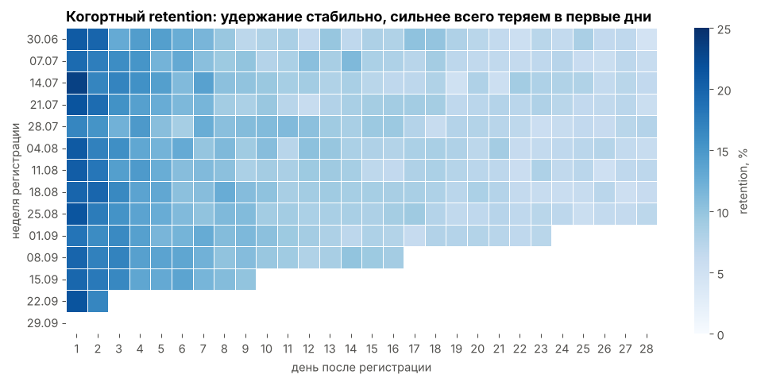
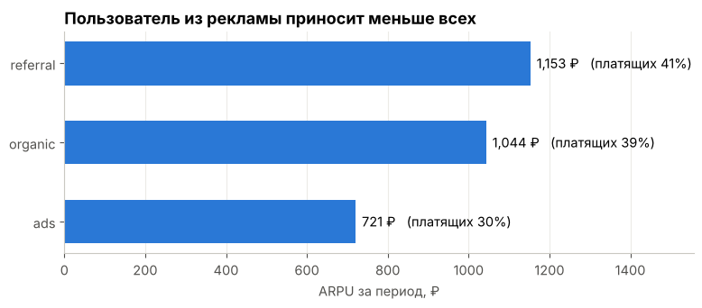
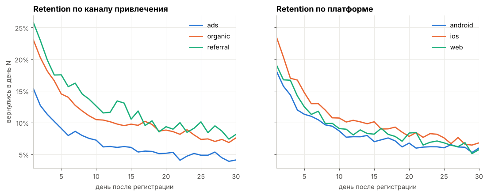

# Продуктовая аналитика и A/B-тест мобильного приложения

Анализ поведения пользователей мобильного приложения интернет-магазина **ShopFlow** за III квартал 2025 года: метрики активности, воронка покупки, когортный retention, монетизация сегментов и оценка A/B-теста нового экрана оформления заказа.

**Стек:** Python (pandas, NumPy, SciPy, matplotlib, seaborn) · SQL (SQLite) · Jupyter

📓 **Основной анализ:** [`notebooks/analysis.ipynb`](notebooks/analysis.ipynb)

> Данные синтетические: они сгенерированы скриптом [`src/generate_data.py`](src/generate_data.py) и устроены как реальные продуктовые логи — с дубликатами, пропусками и сбоем логирования, которые нужно найти и обработать.

---

## Ключевые результаты

| Область | Результат |
|---|---|
| **Качество данных** | Найдено и удалено 1 973 дубля событий (0.7%); у 2% пользователей нет платформы; 3 августа DAU упал в ~7 раз из-за сбоя логирования |
| **Активность** | DAU вырос с ~300 до ~800; sticky factor ≈ 8% |
| **Воронка** | До покупки доходят 35% пользователей; на экране оформления теряется 31% |
| **Retention** | D1 ≈ 20%, D7 ≈ 11%, D30 ≈ 6%; рекламный трафик удерживается почти вдвое хуже реферального (D30 4.1% vs 8.1%) |
| **Монетизация** | ARPU рекламного трафика на 31% ниже органики при одинаковом среднем чеке |
| **A/B-тест** | Новый экран оформления: конверсия в покупку **24.5% → 27.3% (+12%, p = 0.03)**, ARPU **+21%** (бутстрап 95% ДИ не включает 0) → рекомендован к раскатке |



## Задачи

1. Проверить качество данных и найти аномалии.
2. Посчитать DAU / MAU и sticky factor.
3. Построить воронку от открытия приложения до покупки и найти самый слабый шаг.
4. Оценить retention по недельным когортам, каналам привлечения и платформам.
5. Сравнить монетизацию сегментов (ARPU, доля платящих, средний чек).
6. Проанализировать A/B-тест: проверка разбиения (SRM), z-тест для долей, бутстрап для ARPU, guardrail-метрики, мощность теста.

## Визуализации

| | |
|---|---|
|  |  |
|  |  |



## Рекомендации

1. **Раскатить новый экран оформления заказа** на всех пользователей — он значимо повышает конверсию и выручку, не снижая средний чек.
2. **Пересмотреть рекламный бюджет:** пользователи из рекламы хуже удерживаются и приносят меньше выручки — нужно сопоставить ARPU с CAC по кампаниям.
3. **Масштабировать реферальную программу** — реферальные пользователи самые ценные.
4. **Проверить качество Android-приложения** (крэши, скорость) — удержание на Android ниже, чем на iOS.
5. **Настроить алерт на падение числа событий**, чтобы сбои логирования не искажали отчёты.

## Структура проекта

```
├── data/
│   └── raw/                  # исходные CSV: users, events, ab_groups
├── notebooks/
│   └── analysis.ipynb        # основной анализ с выводами
├── sql/
│   ├── 01_dau_mau.sql        # DAU, MAU, sticky factor
│   ├── 02_funnel.sql         # воронка (оконные функции)
│   ├── 03_retention.sql      # когортный retention D1 / D7 / D30
│   ├── 04_ab_test.sql        # метрики A/B-теста по группам
│   └── 05_revenue_by_segment.sql
├── src/
│   ├── generate_data.py      # генерация синтетических данных
│   └── build_db.py           # очистка и загрузка CSV в SQLite
├── reports/figures/          # графики из ноутбука
└── requirements.txt
```

## Данные

| Таблица | Строк | Описание |
|---|---|---|
| `users` | 12 000 | пользователь, время регистрации, платформа, канал привлечения, город |
| `events` | 283 850 (до очистки) | события: `app_open`, `view_product`, `add_to_cart`, `checkout`, `purchase` (+ сумма покупки) |
| `ab_groups` | 4 363 | группа A/B-теста для пользователей, зарегистрированных 15.08–14.09.2025 |

## Как запустить

```bash
git clone https://github.com/<your-username>/product-analytics-ab-test.git
cd product-analytics-ab-test
pip install -r requirements.txt

python src/build_db.py          # собрать базу SQLite из CSV (ноутбук сделает это и сам)
jupyter notebook notebooks/analysis.ipynb
```

Чтобы пересоздать данные с нуля: `python src/generate_data.py` (генерация детерминирована, `seed = 42`).
